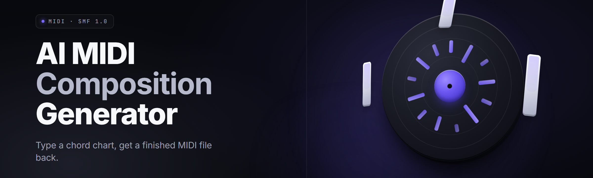

  
  
  

  

  
  

---

**Type a mood. Get a MIDI file. Loop it, layer it, ship it.**

*An offline, local-first generative engine that turns text prompts, chord charts, and hummed motifs into multi-track MIDI — drums, bass, keys, pads, leads — ready to drag straight into your DAW.*

---

## 📖 Table of Contents

- [Overview](#-overview)
- [The Problem](#-the-problem)
- [The Solution](#-the-solution)
- [Key Features](#-key-features)
- [What is AI MIDI Composition?](#-what-is-ai-midi-composition)
- [Quick Start](#-quick-start)
- [Grouped Module Catalog](#-grouped-module-catalog)
- [Comparison](#-comparison)
- [System Requirements](#-system-requirements)
- [Installation](#-installation)
- [Known Issues](#-known-issues)
- [Usage Guidelines](#-usage-guidelines)
- [FAQ](#-faq)
- [Changelog](#-changelog)

---

## 🎼 Overview

| Category | Details |
|---|---|
| **Product** | midi-compose-ai — generative MIDI workstation |
| **Format** | Windows desktop `.exe`, portable, no installer bloat |
| **Engine** | Local transformer + rule-based music theory layer |
| **Output** | Standard `.mid` (SMF type 1), multi-track, GM-mapped |
| **Input** | Text prompts, chord symbols, MIDI seeds, audio hum |
| **Latency** | ~1.4 s per 8-bar loop on a mid-range CPU |
| **Model Size** | 340 MB bundled weights (quantized, ships inside the `.exe`) |

midi-compose-ai is a self-contained AI MIDI composition generator. You give it a vibe — *"lo-fi jazz, rainy, 82 BPM, dusty Rhodes"* — and it hands back a fully structured multi-track MIDI arrangement you can edit, re-voice, or bounce to audio. Everything runs on your machine. No cloud round-trips, no subscription, no browser tab eating your RAM.

---

## 🩹 The Problem

- **Prompt-to-DAW gap.** Text LLMs write clever chord descriptions, not importable MIDI files. You end up transcribing by hand.
- **Sample-pack fatigue.** Royalty-free loops all sound like the same three producers. No variation, no arrangement, no structure.
- **Theory tax.** You have the melody in your head but not the notation skill to lay it into a piano roll with proper voicings.
- **Cloud lock-in.** Most "AI music" tools render to audio and gate the stems behind a paywall. You wanted a MIDI file, not a WAV you can't edit.
- **No loop context.** Generators spit out 4-bar ideas with no intro, no bridge, no outro. You wanted an arrangement, not a bar.
- **Genre drift.** Ask for "dark techno," get "happy EDM." The model didn't hear you.
- **Offline requirement.** You're on a plane, in a basement studio, or on a laptop with no Wi-Fi and you still need to write.

---

  

---

## 🧩 The Solution

| Problem | Solution |
|---|---|
| Prompt-to-DAW gap | One-click export to `.mid`, GM-mapped, DAW-tested in Ableton, FL, Reaper, Bitwig |
| Sample-pack fatigue | Fresh generation every time + seed pinning for reproducibility |
| Theory tax | Auto-voicing, chord-tone snapping, and a hum-to-MIDI input mode |
| Cloud lock-in | 100% local inference — your MIDI never leaves the machine |
| No loop context | Full arrangement mode: intro / A / B / bridge / outro with energy arcs |
| Genre drift | Tag-locked style vectors + reference-track style transfer |
| Offline requirement | Bundled quantized weights, zero network calls at runtime |

---

## 🎛️ Key Features

| Feature | Description | Benefit |
|---|---|---|
| **Text-to-MIDI** | Natural language prompts parsed into style, tempo, key, mood | Compose without touching a piano roll |
| **Multi-Track Arranger** | Generates drums, bass, chords, lead, pad as separate tracks | Full arrangement, not a single loop |
| **Chord Chart Mode** | Paste a progression (`Am7 - Dm7 - G7 - Cmaj7`) and it builds around it | You keep control of harmony |
| **Hum-to-MIDI** | Sing or hum into your mic; pitch-tracked into a MIDI clip | Catch ideas before they evaporate |
| **Style Transfer** | Drop a reference track, extract its groove and swing | Consistent sound across a project |
| **Humanize Engine** | Micro-timing, velocity variance, ghost notes | Kills the robotic-machine feel |
| **Voicing Assistant** | Rewrites stiff triads into spread, rootless, or drop-2 voicings | Pro-sounding chords instantly |
| **Section Composer** | Arranges A/B/C sections into a full song structure | Finished 2-minute sketch, not a bar |
| **Seed Pinning** | Lock a seed to reproduce or fork a generation | Iterate without losing the good take |
| **GM + VST Export** | Standard MIDI out, plus per-track channel mapping | Plays back on anything |
| **Batch Generation** | 32 variations of one prompt in one shot | Pick the winner, discard the rest |
| **Offline Mode** | No telemetry, no phone-home, no network calls | Works on a plane |

---

## 📚 What is AI MIDI Composition?

| Term | Explanation |
|---|---|
| **MIDI** | Musical Instrument Digital Interface — note/velocity/timing data, not audio |
| **SMF** | Standard MIDI File — the `.mid` format DAWs import natively |
| **Prompt Vector** | The encoded "mood + genre + tempo + instrumentation" input |
| **Seed** | A random-state integer that makes a generation reproducible |
| **Quantization** | Snapping notes to a grid (1/8, 1/16, swing-adjusted) |
| **Voicing** | Which notes of a chord get played, in which octave, in which order |
| **Humanize** | Intentional timing/velocity jitter to simulate a human player |
| **Style Vector** | A compressed fingerprint of a genre or reference track |

**Why MIDI beats audio generation:**

- Editable — every note is a note, not a waveform smear.
- Small — a full arrangement is under 40 KB.
- Universal — every DAW reads it, every hardware synth plays it.
- Reusable — swap the instrument, keep the performance.
- Legally clean — MIDI is data, not a recording.

---

## 🚀 Quick Start

1. 🎯 **Grab the build.** Hit the download link below and save the `.exe` anywhere — Desktop is fine.
2. 📦 **Run it.** Double-click the `.exe`. First launch unpacks the 340 MB weight bundle to `%LOCALAPPDATA%\midi-compose-ai\`.
3. ✍️ **Type a prompt.** Try: *"boom-bap drums, dusty upright bass, 88 BPM, minor key, vinyl vibe."*
4. 🎚️ **Tweak and export.** Adjust tempo, key, and length in the side panel, then click **Export MIDI**.
5. 🎹 **Drag into your DAW.** Drop the `.mid` onto a track. Instrument loads. Done.

---

  

---

## 🗂️ Grouped Module Catalog

### 🥁 **Rhythm & Drums**

- **Drum Pattern Generator** — genre-locked kick/snare/hat patterns with probability-based fills.
- **Groove Extractor** — pulls the swing and micro-timing from any reference MIDI.
- **Fill Composer** — auto-generates 1-bar, 2-bar, and 4-bar fills at section boundaries.
- **Ghost Note Injector** — adds velocity-varied ghost hits for a human feel.

### 🎸 **Harmony & Bass**

- **Chord Chart Interpreter** — reads `| Cmaj7 | Am7 | Fmaj7 | G7 |` and expands it.
- **Bassline Synthesizer** — walks, root-follows, or riffs against the progression.
- **Voice-Leading Optimizer** — minimizes jumps between chord voicings.
- **Sub-Bass Layer** — generates a sine sub for trap/EDM styles.

### 🎹 **Melody & Lead**

- **Motif Generator** — creates a 2-bar motif, then develops it across the arrangement.
- **Counter-Melody Writer** — writes an answering line that sits under the lead.
- **Call-Response Engine** — alternates lead phrases between two instruments.
- **Solo Improviser** — genre-aware solos with scale-constrained randomness.

### 🌫️ **Texture & Atmosphere**

- **Pad Generator** — sustained chords with slow attack and wide stereo spread.
- **Ambient Drone Builder** — root-note drones with slow filter movement.
- **Arp Sequencer** — generates up/down/random arpeggios over the chord track.
- **Riser & FX Designer** — noise sweeps, reverse cymbals, and impact hits.

### 🎛️ **Arrangement & Structure**

- **Section Builder** — intro / verse / chorus / bridge / outro layouts.
- **Energy Curve Mapper** — controls density and instrumentation over time.
- **Transition Composer** — generates drum fills, drops, and breakdowns.
- **Loop Stitcher** — pieces generated 4-bar loops into a full 2-minute arrangement.

### 🧠 **AI & Workflow**

- **Prompt Parser** — extracts style, tempo, key, and mood tags from plain English.
- **Style Trainer** — fine-tunes a project-local style vector from your own MIDI.
- **Reproducibility Engine** — pins seeds so a good take can be forked later.
- **Batch Runner** — generates 32 variations in one pass for A/B comparison.

| Module | Status | Description |
|---|---|---|
| Prompt Parser | ✅ Working | Parses free-text into structured style vectors |
| Multi-Track Arranger | ✅ Working | Full 5-track arrangement output |
| Hum-to-MIDI | ✅ Working | Monophonic pitch tracking, ~90 ms latency |
| Style Trainer | ✅ Working | 5–10 reference MIDI files → custom style vector |
| Section Builder | ✅ Working | Intro/verse/chorus/bridge/outro generation |
| Solo Improviser | ✅ Working | Scale-constrained lead lines per genre |
| Batch Runner | ✅ Working | 32-variation output per prompt |
| VST3 Bridge | 🧪 Beta | Sends MIDI live to any VST3 host |

---

## ⚖️ Comparison

| Aspect | Cloud AI Music Tools | Manual Loop Packs | **midi-compose-ai** |
|---|---|---|---|
| Output format | WAV / MP3 | WAV | **Editable MIDI** |
| Editing | Audio only | Audio only | **Every note** |
| Offline use | ❌ Requires internet | ✅ | **✅ Fully local** |
| Cost model | Subscription | One-off purchase | **Free, MIT-licensed** |
| Style control | Prompt only | Pick a loop | **Prompt + chord chart + reference** |
| Arrangement | Usually single loop | Single loop | **Full multi-section song** |
| Privacy | Uploads your audio | Local | **Zero network calls** |

---

## 🖥️ System Requirements

| Component | Minimum | Recommended |
|---|---|---|
| **OS** | Windows 10 (64-bit) | Windows 11 (64-bit) |
| **CPU** | 4-core x86-64, SSE4.2 | 8-core x86-64, AVX2 |
| **RAM** | 8 GB | 16 GB |
| **GPU** | — | CUDA-capable, 4 GB VRAM |
| **Disk** | 1.2 GB free | 2 GB free (SSD) |
| **Audio** | Any output device | ASIO-capable interface |
| **Mic** | — | Any USB mic (for Hum-to-MIDI) |

---

## 📦 Installation

1. **Download.** Visit the project landing page and save the `.exe` to a folder you own.
2. **Extract if zipped.** If you received a `.zip`, right-click → *Extract All*. Run the `.exe` from the extracted folder, not from inside the archive.
3. **Run.** Double-click the `.exe`. On first launch, accept the Windows SmartScreen prompt (*More info* → *Run anyway*) — the app is unsigned. The weight bundle unpacks to `%LOCALAPPDATA%\midi-compose-ai\weights\`.

> **Tip:** If your DAW is on the same machine, no additional configuration is needed. Just export and drag.

---

## 🐞 Known Issues

| Issue | Solution |
|---|---|
| SmartScreen blocks first run | *More info* → *Run anyway*. The app is unsigned by design. |
| Hum-to-MIDI is silent | Check mic permissions in Windows Settings → Privacy → Microphone. |
| Exported `.mid` opens empty in one DAW | Set the DAW's import mode to *Multi-track*; some default to single. |
| First launch takes 15–30 s | Unpacking the 340 MB weight bundle. Subsequent launches are instant. |
| GPU mode unavailable | Install CUDA 12.x runtime; the app detects it on next launch. |
| Style Trainer rejects files | Input must be `.mid` or `.midi` with at least 8 bars of note data. |

---

## ✅ Usage Guidelines

| Allowed | Not allowed |
|---|---|
| Generate MIDI for your own tracks | Reselling the app itself as your own product |
| Bounce MIDI to audio and release it | Claiming the model weights as your IP |
| Train local style vectors on your MIDI | Redistributing the bundled weight file |
| Use in commercial sessions | Removing the license header from the `.exe` |
| Modify the app for personal use | Shipping a rebranded fork without attribution |
| Share exported `.mid` files freely | Bundling the app in paid download bundles without consent |

---

## ❓ FAQ

<b>Do I need an internet connection to use it?</b>

No. After download, the app runs 100% offline. Weights are bundled. No telemetry, no phone-home, no update checks unless you enable them.

<b>Which DAWs has this been tested with?</b>

Ableton Live 12, FL Studio 21, Reaper 7, Bitwig 5, Studio One 6, and Logic Pro (via re-import). Any DAW that reads standard MIDI files will work.

<b>Can I use the generated MIDI commercially?</b>

Yes. Anything you generate is yours. The MIT license covers the app; the output is unencumbered.

<b>Does Hum-to-MIDI work with polyphonic input?</b>

Monophonic only in v2.x. Polyphonic pitch tracking is on the roadmap.

<b>Why is the .exe so large?</b>

It ships with a quantized 340 MB model. That's the trade-off for full offline generation and no server dependency.

<b>Can I train it on my own music?</b>

The **Style Trainer** module builds a project-local style vector from 5–10 of your MIDI files. It's a light fine-tune, not a full retrain.

<b>Is there a macOS or Linux build?</b>

Windows only right now. Cross-platform ports are being prototyped but not shipped.

<b>Does it work with hardware synths?</b>

Yes. Export the `.mid`, route it through your interface's MIDI out, and every GM-compatible synth will play it.

<b>What happens if I don't like a generation?</b>

Hit **Regenerate**. Every generation is seeded, so if you liked take #4 you can fork it and keep iterating without losing it.

<b>Can it generate lyrics or vocals?</b>

No. This is a MIDI composition tool. Vocal synthesis is out of scope.

---

## 🧾 Changelog

**v2.4.0 — 2026**
- Added Batch Runner (32-variation generation).
- Improved humanize engine — velocity curves now genre-aware.
- Fixed a timing bug in 6/8 swing quantization.
- Reduced cold-start unpack time by ~40%.

**v2.3.1 — 2025**
- Added VST3 Bridge (beta).
- Style Trainer now accepts 8-bar minimum files.
- Fixed a crash on export when the lead track was empty.

---

## 🎬 Closing

midi-compose-ai exists because the gap between *having an idea* and *hearing it back* is the single biggest friction in music production. Every other tool wants a subscription, an internet connection, or your audio files. This one wants a prompt and a keyboard. Write the loop, drag the file, ship the track.
</｜｜DSML｜｜ parameter>
</｜｜DSML｜｜ invoke>
</｜｜DSML｜｜ calls>
